# Mars Surface Weather Desk

A student showcase project that turns NASA's InSight Mars weather feed into a daily **GO / CAUTION / NO-GO** call for wind-sensitive surface work, with a dashboard on top.

It demonstrates a batch data pipeline end to end:

**Batch ingestion API → object storage → dbt warehouse → dashboard**

---

## 1. Business problem

NASA's InSight lander (Elysium Planitia, 2018–2022) recorded weather every Martian day, or *sol*. Its public feed, the [InSight Mars Weather Service API](https://api.nasa.gov/assets/insight/insight_mars_wind_rose.html), has three properties that make it awkward to use directly:

1. **It is a rolling window, not a log.** Each response re-sends the most recent sols, so the same day shows up in many responses, and NASA can revise it.
2. **The data is shaped for display, not analysis.** Sol numbers are JSON *keys*, the wind histogram is nested by compass bin, and missing bins are simply absent.
3. **Quality varies.** Some sols have only partial sensor coverage, and the feed can freeze.

A mission operations desk that wants to plan wind-sensitive work (for example, moving an arm or setting up a wind-sensitive instrument) needs three things from that feed:

- **A single, trusted number per sol.** One row per day, with the latest revision, and no double counting from overlapping windows.
- **A clear decision, with its reason.** "CAUTION, peak wind 23.2 m/s exceeds the 20 m/s limit" is more useful than a raw table.
- **Evidence that the pipeline is healthy.** Did today's pull bring new data, or is the feed frozen?

This project answers those three needs. The GO / CAUTION / NO-GO thresholds are **illustrative**: they were chosen from the spread of the InSight data, not from an engineering specification.

## 2. Architecture

```mermaid
flowchart LR
    API["NASA InSight Weather API<br/>api.nasa.gov/insight_weather"]
    subgraph Ingest["Batch ingestion (Python)"]
        CLIENT["nasa_client.py<br/>retries, X-Api-Key header"]
        INGEST["ingest.py<br/>validate, then land"]
    end
    LAKE[("Object storage<br/>raw/insight_weather/dt=YYYYMMDD/<br/>insight_weather_&lt;UTC&gt;.json<br/>(local dir; GCS-compatible layout)")]
    subgraph Warehouse["dbt-duckdb warehouse"]
        SRC["source: raw.insight_weather_files"]
        STG["staging<br/>stg_insight__ingestion_files<br/>stg_insight__sol_payloads<br/>stg_insight__sol_readings<br/>stg_insight__wind_direction"]
        MARTS["marts<br/>fct_sol_weather<br/>fct_sol_wind_rose<br/>mart_ops_briefing<br/>mart_ingestion_audit"]
    end
    DASH["Streamlit dashboard<br/>dashboard/app.py"]

    API -->|"HTTPS GET"| CLIENT --> INGEST -->|"immutable JSON per run"| LAKE
    LAKE --> SRC --> STG --> MARTS --> DASH
```



| Layer | What it does | Where |
|---|---|---|
| **Ingestion** | Calls the API, validates the payload shape, writes the response byte for byte to the object store. A malformed response is rejected *before* it is written. | `src/mars_weather/nasa_client.py`, `ingest.py` |
| **Object storage (raw)** | Immutable, timestamped JSON per run, partitioned by `dt=`. Nothing is overwritten, so the raw layer can always be replayed. | `data/lake/` (git-ignored) |
| **Staging (dbt)** | Reads the raw files, turns sol keys into rows, keeps the latest copy of each sol, and casts the JSON to typed columns. | `dbt/models/staging/` |
| **Marts (dbt)** | Business-facing tables: one row per sol, the ops decision and its reason, the wind rose, and pipeline health. | `dbt/models/marts/` |
| **Dashboard** | A thin Streamlit page that reads the marts only. | `dashboard/app.py`, `src/mars_weather/queries.py` |

**Why an object store in the middle?** The raw layer is the system of record. If a business rule changes (for example, a new wind limit), we rebuild the marts from the stored JSON. We do not need to call NASA again, and the feed may no longer be available.

**Why the dedupe happens in the warehouse, not at ingestion?** Ingestion stays simple and lossless. The warehouse decides which copy of a sol is authoritative, so the rule can change without touching the raw data.

## 3. Data model

| Model | Grain | Purpose |
|---|---|---|
| `stg_insight__sol_payloads` | 1 row per sol | Latest landed copy of each sol's JSON (latest wins) |
| `stg_insight__sol_readings` | 1 row per sol | Typed temperature, wind, pressure, season, and sensor coverage |
| `stg_insight__wind_direction` | 1 row per sol × 16 compass bins | Wind histogram; missing bins filled with 0 |
| `fct_sol_weather` | 1 row per sol | The trusted daily fact, with an `is_complete` flag |
| `fct_sol_wind_rose` | 1 row per sol × bin | Share of wind samples per direction |
| `mart_ops_briefing` | 1 row per sol | `ops_status` (GO / CAUTION / NO_GO / NO_DATA), `ops_status_reason`, 7-sol rolling context, day-over-day pressure change |
| `mart_ingestion_audit` | 1 row per batch run | Sols returned, new, and repeated, plus a running count of distinct sols |

**Business rules** live in `dbt/dbt_project.yml` as variables, not inside SQL:

| Variable | Value | Meaning |
|---|---|---|
| `ops_caution_avg_wind_ms` | 7 m/s | Average wind above this → CAUTION |
| `ops_caution_gust_ms` | 20 m/s | Peak wind above this → CAUTION |
| `ops_nogo_gust_ms` | 25 m/s | Peak wind above this → NO_GO |
| `min_sensor_hours` | 18 of 24 | A sensor must cover this many sol-hours, or the sol is `NO_DATA` |

A sol is `NO_DATA` (not GO) when coverage is too low. A sol with missing data is not treated as safe.

## 4. Data quality and tests

Two layers of tests run automatically:

- **dbt tests (53 dbt nodes in the build, including the data tests):** `not_null`, `unique`, `accepted_values`, and `relationships` checks. Singular tests assert the physical sanity of the data (min ≤ average ≤ max for temperature, wind, and pressure), that every sol has exactly 16 wind bins that sum to 1, that the compass seed matches what the API reports, and that the audit reconciles with the fact table.
- **Python tests (`tests/`, 10 tests):**
  - `test_mars_storage.py` (1): round trip, and keys cannot escape the store.
  - `test_mars_client.py` (2): a transient error is retried, and the API key is sent in a header and never appears in URLs or errors. A rejected key fails fast with a hint.
  - `test_mars_ingest.py` (2): a valid payload is stored byte for byte under the key layout the dbt source expects. An invalid payload is rejected before anything is written.
  - `test_mars_warehouse.py` (3): these build the real dbt project from test data. Overlapping pulls collapse to one row per sol with the latest revision. The ops rules flag high wind and insufficient data. A frozen feed adds no new data, and the audit reports it.
  - `test_mars_dashboard.py` (2): the Streamlit page renders against a real warehouse, and a frozen feed shows an explanation.

The warehouse tests run the real dbt project, including its data tests, so they prove the business rules and de-duplication without mocked SQL. The API is faked in the client tests, so no network or key is needed.

## 5. Quick start

Requirements: Python 3.10 or newer, and `make`.

```bash
cd student_projects/mars_weather

make setup          # one time: creates .venv and installs pinned dependencies
make demo           # no API key needed: loads the bundled NASA sample and runs dbt
make test           # runs the Python tests, which also run dbt on test data
make dashboard      # opens the dashboard at http://localhost:8501
```

To use **live** NASA data, get a free key at [api.nasa.gov](https://api.nasa.gov) and create a git-ignored `.env` file:

```bash
cp .env.example .env     # then replace the placeholder with your key
make pipeline            # live pull from the API, then dbt build
make dashboard
```

Other targets:

| Command | What it does |
|---|---|
| `make ingest` | Live API pull only (lands raw JSON) |
| `make ingest-sample` | Lands the bundled sample instead of calling the API |
| `make dbt-build` | Builds all models and runs all dbt tests |
| `make docs` | Generates dbt docs and lineage graph at http://localhost:8080 |
| `make clean` | Deletes the generated lake, warehouse, and dbt artifacts |
| `make help` | Lists every target |

Run `make demo` (or `make pipeline`) before `make dashboard`. Until the warehouse exists, the dashboard shows a message asking you to run the pipeline.

### Configuration

| Variable | Default | Purpose |
|---|---|---|
| `NASA_API_KEY` | none (required for live pulls) | API key, read from `.env` or the environment |
| `NASA_API_URL` | `https://api.nasa.gov/insight_weather/` | API endpoint |
| `LAKE_PATH` | `data/lake` | Object-store root |
| `WAREHOUSE_PATH` | `data/warehouse/mars_weather.duckdb` | DuckDB file used by dbt and the dashboard |

## 6. Project layout

```
mars_weather/
├── Makefile                  # entry points: setup, demo, pipeline, test, dashboard, docs
├── requirements.txt          # direct dependencies
├── requirements.lock         # exact versions that were tested together
├── pytest.ini
├── sample_data/
│   └── insight_weather_sample.json   # a real API response (7 sols, no key)
├── src/mars_weather/
│   ├── config.py             # settings from environment variables
│   ├── nasa_client.py        # API client: retries, key handling, payload validation
│   ├── storage.py            # object-store interface and local implementation
│   ├── ingest.py             # lands a payload in the object store (CLI)
│   └── queries.py            # read-only queries behind the dashboard
├── dbt/
│   ├── dbt_project.yml       # project config and business-rule variables
│   ├── profiles.yml          # DuckDB connection
│   ├── macros/insight.sql    # JSON-parsing helpers
│   ├── seeds/compass_bins.csv
│   ├── models/staging/       # raw → typed, de-duplicated
│   ├── models/marts/         # business tables
│   └── tests/                # singular data tests
├── dashboard/app.py          # Streamlit dashboard
└── tests/                    # Python tests and shared fixtures
```

## 7. Design decisions

- **Live key stays out of the data.** The key is sent in an `X-Api-Key` header, not in the URL. It is never written to the lake, the warehouse, or the logs. The tests check this.
- **Validate before write.** A response that is not the expected shape is rejected, so the raw layer only contains usable payloads. Empty responses are still stored, so the audit trail shows that a run happened.
- **Latest wins, with the history kept.** NASA can revise a sol. The warehouse uses the most recent copy, and `times_ingested` records how often each sol was delivered.
- **Missing is not zero, except for the wind rose.** A missing wind bin means "no samples from that direction", so it is filled with 0. A sol with low sensor coverage is `NO_DATA`, not GO.
- **Thresholds are data, not code.** They are dbt variables. The dashboard reads them from the mart, so the chart and the rule always match.
- **Storage is swappable.** `ObjectStore` has three methods (`put`, `get`, `list`). A GCS or S3 implementation would replace `LocalObjectStore`, and the key layout is already cloud-style (`dt=` partitions).
- **No network in tests.** The API is faked and fixtures are built from the saved sample. The project's dependency versions are pinned in `requirements.lock`.

## 8. Limitations

- **The feed may be frozen.** The InSight mission ended in 2022. When the API stops advancing, `mart_ingestion_audit` shows runs with zero new sols, and the dashboard says so instead of presenting old data as current.
- **The thresholds are illustrative**, as stated above. They are not an engineering or safety standard.
- **Storage is local.** The "object store" is a directory. The layout matches a cloud bucket, but nothing has been deployed to GCS or S3.
- **No scheduler.** `make pipeline` is run by hand. In production it would be an Airflow or cron job.
- **Single site.** The data is for one lander at Elysium Planitia.

## 9. Tested with

Python 3.10.7, dbt-core 1.12.7 with dbt-duckdb 1.11.1, DuckDB 1.5.6, Streamlit 1.65.0, pytest 9.2.0, on macOS. The exact versions are in `requirements.lock`.

---

## Summary

**What it is**

- A student project that turns NASA's InSight Mars weather feed into a daily GO / CAUTION / NO-GO call for wind-sensitive surface work, with a dashboard.
- Pipeline: NASA API → Python ingestion → raw JSON files (object-store layout) → dbt models in DuckDB → Streamlit dashboard.

**Why it's interesting**

- The raw feed re-sends overlapping windows of sols, so the same day arrives many times. The warehouse keeps one row per sol with the latest revision.
- Business rules (wind thresholds, minimum sensor coverage) live as dbt variables, so the dashboard and the rules always agree.
- The raw layer is immutable, so the marts can be rebuilt from stored data even if NASA's feed stops.

**Quality and testing**

- 10 Python tests cover the client's retries and key handling, the ingestion contract, and warehouse outcomes. The warehouse tests run the real dbt project.
- dbt runs 53 nodes, including data tests for uniqueness, ranges, and reconciliation of the audit against the fact table.
- The API key stays out of URLs, logs, and stored data.

**Honest limitations**

- The InSight mission has ended, so the feed is effectively frozen. The audit table and dashboard show when a run brings no new data.
- The GO / CAUTION / NO-GO thresholds are illustrative, not an engineering standard.
- Storage is a local directory that follows a cloud bucket layout. Nothing is deployed to GCS, and nothing is scheduled.

**How to run it**

- `make setup`, then `make demo` for the bundled sample (no API key needed), then `make dashboard`. Live data uses a key in a git-ignored `.env` file.
